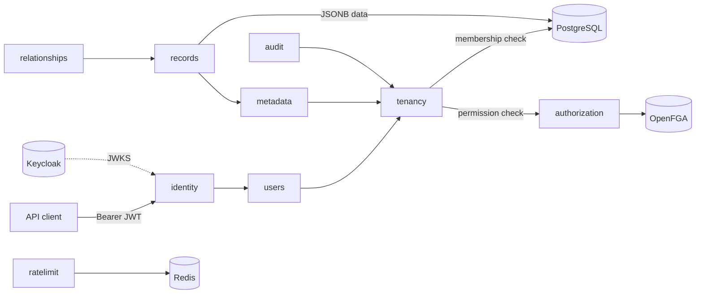

# BM4A - Base Model For All

BM4A is a reusable, project-agnostic foundation for metadata-driven, multi-tenant business applications (CRM, ERP,
HRMS, placement CRM, school/hospital ERP, inventory, ...). Applications are built by **configuring** modules, fields,
relationships and permissions through the API, not by writing a new backend per domain.

Status: first milestone (secure, runnable, tested platform slice). See [BM4A_Roadmap.md](BM4A_Roadmap.md) and the
[implementation report](docs/implementation/IMPLEMENTATION_REPORT.md).

## What is implemented

- **Identity**: Keycloak OIDC; JWTs validated for signature, issuer, audience and expiry; internal users keyed by
  `(issuer, subject)`; profiles and preferences.
- **Tenancy**: organizations, settings, memberships (owner/admin/member), server-side tenant context, lifecycle
  (archive, platform suspend/reactivate).
- **Authorization**: OpenFGA relationship-based checks behind an adapter; tuples synchronized through a transactional
  outbox; fails closed (503) when OpenFGA is unavailable.
- **Metadata engine**: tenant and platform-global modules, 17 field types, validation rules, layouts, definition
  versions and safe schema evolution.
- **Record engine**: one generic CRUD API for every module, JSONB storage with canonical values, optimistic
  concurrency, filtering/sorting/search, history, soft delete/restore/revert, unique fields, lookups.
- **Relationships**: one-to-one, one-to-many, many-to-many links with cardinality enforcement and restrict/detach
  delete behavior.
- **Audit**: append-only audit trail (DB-enforced) with redaction and correlation IDs.
- **Operations**: health probes, metrics, structured logs (prod), Redis-backed rate limiting of writes, Docker, CI.

## Architecture

A Spring Boot modular monolith. Module boundaries are verified by Spring Modulith (`ModularityTests`).



| Module (`com.bm4a.platform.modules.*`) | Responsibility |
|----------------------------------------|----------------|
| `shared` | Problem-details error model, paging, ETags, correlation IDs, JSON/SQL helpers |
| `identity` | Resource-server security, JWT validation |
| `users` | Internal user mapping, `CurrentUser`, `/api/v1/me` |
| `authorization` | `AuthorizationService` port, OpenFGA adapter, model bootstrap, tuple sync |
| `tenancy` | Organizations, memberships, `TenantAccess` -> `TenantContext` |
| `audit` | Append-only audit events and audit API |
| `metadata` | Module/field/layout definitions, `FieldValues` canonical validation |
| `records` | Generic record engine |
| `relationships` | Relationship definitions and record links |
| `ratelimit` | Redis fixed-window rate limiting for mutating requests |

Key decisions: [ADR-001 dynamic record storage](docs/architecture/ADR-001-dynamic-record-storage.md),
[ADR-002 tenancy and authorization](docs/architecture/ADR-002-tenancy-and-authorization.md).

## Repository layout

```
platform/          Spring Boot application (Maven wrapper, Dockerfile, Flyway migrations, tests)
infrastructure/    Docker Compose for PostgreSQL 18, Keycloak 26.3, OpenFGA v1.22.0, Redis 8.2 (+ platform, profile "app")
docs/              Architecture decisions, implementation docs, API guide, operations notes, examples
scripts/           dev-token.sh, seed-demo.sh, smoke-test.sh
.github/workflows/ CI: build + tests, Docker image build, compose validation
```

## Prerequisites

- JDK 25 (only needed to run outside Docker), Docker with Compose v2, `curl` and `jq` (for the scripts)
- Free local ports: 2345 (PostgreSQL), 2346 (Keycloak), 2347 (OpenFGA), 2349 (Redis), 8080 (platform)

## Quick start (clean checkout)

```bash
# 1. Configuration (development placeholders; change the "change-me" values if you like)
cp infrastructure/.env.example infrastructure/.env
cp platform/.env.example platform/.env          # keep passwords/keys in sync with infrastructure/.env

# 2. Dependencies: PostgreSQL, Keycloak (realm "bm4a" imported), OpenFGA, Redis - wait until all are healthy
docker compose -f infrastructure/docker-compose.yml up -d
docker compose -f infrastructure/docker-compose.yml ps

# 3a. Platform from source (Flyway migrates the schema; the local profile bootstraps the OpenFGA store/model)
cd platform && ./mvnw spring-boot:run -Dspring-boot.run.profiles=local
# 3b. ...or everything in Docker instead of 3a
docker compose -f infrastructure/docker-compose.yml --profile app up -d --build

# 4. Try it
scripts/smoke-test.sh                            # 28 end-to-end checks
scripts/seed-demo.sh                             # demo organization with the ExampleAsset module
TOKEN=$(scripts/dev-token.sh alice); curl -H "Authorization: Bearer $TOKEN" localhost:8080/api/v1/me
open http://localhost:8080/swagger-ui.html
```

Development users (realm `bm4a`, **local development only**): `alice` / `alice-dev-password`, `bob` /
`bob-dev-password`, `platform-admin` / `admin-dev-password` (realm role `bm4a-platform-admin`). Keycloak admin
console: `http://localhost:2346` with `KEYCLOAK_ADMIN_USER` / `KEYCLOAK_ADMIN_PASSWORD` from `infrastructure/.env`.

## Configuration

Spring profiles: `local` (developer machine; reads `platform/.env`, OpenFGA bootstrap on, detailed health),
`prod` (no defaults, every value required, ECS JSON logs, API docs off), `test` (Testcontainers).

| Variable | Purpose | Local default |
|----------|---------|---------------|
| `PLATFORM_DB_HOST`, `PLATFORM_DB_PORT`, `PLATFORM_DB`, `PLATFORM_DB_USER`, `PLATFORM_DB_PASSWORD` | PostgreSQL (prod: `PLATFORM_DB_URL`) | `localhost:2345/platform` |
| `KEYCLOAK_ISSUER_URI` | Exact expected `iss` claim | `http://localhost:2346/realms/bm4a` |
| `KEYCLOAK_JWK_SET_URI` | Where signing keys are fetched (may differ inside container networks) | issuer + `/protocol/openid-connect/certs` |
| `KEYCLOAK_AUDIENCE` | Required `aud` entry | `bm4a-api` |
| `OPENFGA_API_URL`, `OPENFGA_PRESHARED_KEY` | OpenFGA HTTP API and pre-shared key | `http://localhost:2347` |
| `OPENFGA_STORE_NAME` / `OPENFGA_STORE_ID`, `OPENFGA_MODEL_ID` | Store/model (IDs required when bootstrap is off, i.e. prod) | `bm4a` |
| `REDIS_HOST`, `REDIS_PORT` | Redis (rate limiting only; never a source of truth) | `localhost:2349` |
| `RATE_LIMIT_ENABLED`, `RATE_LIMIT_WRITES_PER_MINUTE` | Write rate limit per user | `true`, `300` |
| `API_DOCS_ENABLED` | Publish OpenAPI/Swagger UI in `prod` | `false` |

Secrets are only ever supplied through environment variables or the untracked `.env` files. Committed values in
`*.env.example` and `infrastructure/keycloak/realms/bm4a-realm.json` are development placeholders.

## Database migrations

Flyway runs on startup (`platform/src/main/resources/db/migration`, V1-V7); Hibernate only validates. The schema is
fully reproducible from migrations: `V1` Modulith event outbox, `V2` users, `V3` tenancy, `V4` audit, `V5` metadata,
`V6` records, `V7` relationships. Never edit an applied migration; add a new version.

## Tests

```bash
cd platform && ./mvnw -B verify       # requires a running Docker daemon (Testcontainers)
```

Unit tests plus integration tests against real PostgreSQL 18, OpenFGA v1.22.0 and Redis containers. Tokens are
signed with a test key and validated by the production validator chain (issuer, audience, expiry). Highlights:
cross-tenant isolation, forged tenant headers, revocation, permission matrix, fail-closed authorization, record
validation, concurrency, filtering/injection, relationships, append-only audit. CI runs the same command.

## API

See the [API guide](docs/api/README.md) (conventions, walkthrough, endpoint/permission reference) and the
[request collection](docs/api/bm4a.http). Interactive docs at `/swagger-ui.html` (local).

## Troubleshooting

| Symptom | Fix |
|---------|-----|
| Keycloak/OpenFGA fail to log in to PostgreSQL after updating | The Postgres init script runs only on an empty volume. Recreate local data: `docker compose -f infrastructure/docker-compose.yml down -v` (deletes local data). |
| Every API call returns 401 | Token issuer must equal `KEYCLOAK_ISSUER_URI` exactly (`http://localhost:2346/realms/bm4a`) and contain audience `bm4a-api` (use `scripts/dev-token.sh`, client `bm4a-cli`). Expired tokens (5 min) are rejected. |
| 503 `authorization_unavailable` | OpenFGA is unreachable or the pre-shared key differs between `infrastructure/.env` and `platform/.env`. Requests fail closed by design. |
| Startup fails: `store-id and model-id are required` | Bootstrap is off outside the `local` profile; set `OPENFGA_STORE_ID`/`OPENFGA_MODEL_ID` or run with `local`. |
| `Port is already allocated` | Another stack uses 2345-2349 or 8080. Stop it or change the host port in the compose file / `SERVER_PORT`. |
| Tests fail with "Could not find a valid Docker environment" | Start Docker; integration tests need it. |
| 429 `rate_limited` while scripting | Raise `RATE_LIMIT_WRITES_PER_MINUTE` or set `RATE_LIMIT_ENABLED=false` locally. |
| Old `bm4a-network` network | No longer used (compose now uses its default network): `docker network rm bm4a-network`. |
